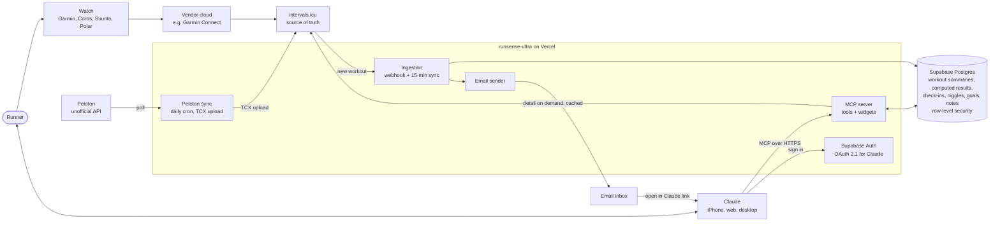
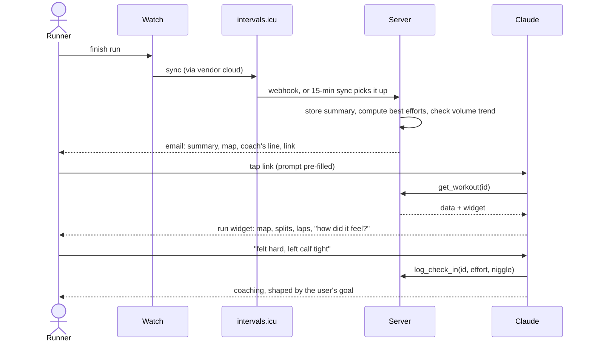

# Architecture

Two pictures: how the parts fit together, and what happens after a run. Both render on GitHub. Keep them current when a component or flow changes.

## The system



**Boundaries.** intervals.icu owns the raw data. The server owns summaries, computed results and what the user tells us, all keyed by user with row-level security. Claude owns the conversation, memory and voice. Secrets live only in Vercel and Supabase settings.

**Database.** One table so far, `workouts`: one summary row per workout per user, keyed by user, source and the source's id, with row-level security that lets the signed-in Supabase user reach only their own rows. The schema lives in `src/db/schema.ts`; Drizzle generates the SQL migrations from it and applies them to Supabase. Tests apply the same migrations to PGlite, an in-memory Postgres, with a stub of Supabase's `auth.uid()` and `authenticated` role so the policies are exercised too. Nothing writes to the table yet; per-user ingestion arrives in Phase 1.

## After a run



## Code layout

One Next.js app. Dependencies point one way, down this list; nothing imports from `app/`.

```
src/domain      model, maths and formatting: workouts, splits, route simplification, static-map geometry, the text Claude reads, the TCX builder, the email. Pure TypeScript, no I/O
src/sources     intervals.icu and Peloton clients, and mappers from their shapes to ours, with anonymised fixtures; the Resend email sender
src/db          the Drizzle schema, its SQL migrations, the Supabase connection, and the queries that turn rows into domain types; a PGlite helper for tests
src/services    use cases: recent workouts, one workout in detail, the Peloton sync, email a finished workout, decide what to do with an intervals.icu webhook
app/mcp         the MCP endpoint: tools and widget resources, kept thin
app/api/cron    scheduled routes called by Vercel with the cron secret, kept thin
app/api/webhooks the intervals.icu webhook route, a few lines of wiring
app/            the landing and privacy pages, the widgets (one page each) and the host bridge hook
scripts/        developer tools, e.g. capturing a fixture from a real account
```

## Peloton rides

Peloton pushes rides only to Strava, Garmin, Apple Health, Fitbit and WHOOP, and none of those reaches the intervals.icu API in a usable form. So a daily cron route logs in to Peloton's unofficial API with the account credentials from Vercel's settings, lists the last week's rides, skips any whose external id intervals.icu already holds, builds a TCX file with power, cadence, heart rate and speed for each new one, and uploads it. intervals.icu then holds the ride like any other, and the MCP tools need no change.

## The email

When intervals.icu posts a webhook to `/api/webhooks/intervals`, the route checks the shared secret the app settings send as the Authorization header, then for each `ACTIVITY_UPLOADED` event belonging to the configured athlete it fetches the workout as `get_workout` would, builds the email in `src/domain/email.ts` (summary, the coach's one line on pacing, a static map when one is available, and an "Open in Claude" button that pre-fills the prompt a tapped history row would send) and sends it through Resend. The button links to our `/open` page, because email clients strip `claude://` links: on a desktop browser the page hands off to the Claude desktop app and falls back to claude.ai; phones go straight to claude.ai. Nothing is stored, so a retried webhook sends again. Opt-in during the single-user phase is the `NOTIFY_EMAIL_TO` setting.

## Widgets

Each widget is a Next.js page served at one stable `ui://` address and rendered by Claude in a sandboxed iframe. The tool result carries everything the widget needs, including the GPS route as a simplified encoded polyline, so the widget makes no calls of its own. Tapping a row in the history widget drills in: the widget calls `get_workout` itself through the host (`tools/call`), shows the detail in place of the list with a way back, and tells Claude what is on screen (`ui/update-model-context`). On a host that does not let widgets call tools, the row instead posts a user message naming the workout, Claude calls `get_workout`, and the detail widget renders as a new turn. Both views share one `WorkoutDetail` component. The map is a static grid of CARTO tile images placed by our own geometry, each carrying the free key from `NEXT_PUBLIC_CARTO_API_KEY`, with the route drawn over them in SVG; without a key, or if a tile fails to load, the route stays on a plain card.
