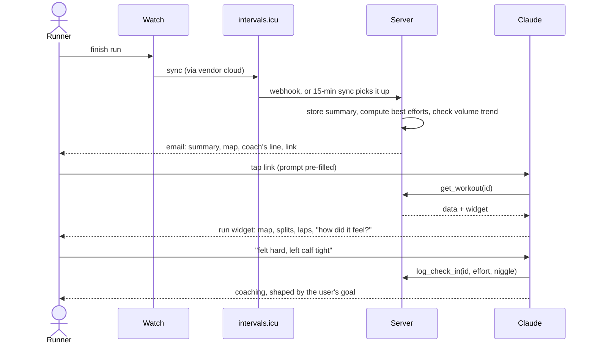

# Architecture

Two pictures: how the parts fit together, and what happens after a run. Both render on GitHub. Keep them current when a component or flow changes.

## The system


**Boundaries.** intervals.icu owns the raw data. The server owns summaries, computed results and what the user tells us, all keyed by user with row-level security. Claude owns the conversation, memory and voice. Secrets live only in Vercel and Supabase settings.

## After a run



## Code layout

One Next.js app. Dependencies point one way, down this list; nothing imports from `app/`.

```
src/domain      model, maths and formatting: workouts, splits, route simplification, static-map geometry, the text Claude reads. Pure TypeScript, no I/O
src/sources     intervals.icu client and mappers from its shapes to ours, with anonymised fixtures; the Resend email sender
src/services    use cases: recent workouts, one workout in detail, email a finished workout, decide what to do with an intervals.icu webhook
app/mcp         the MCP endpoint: tools and widget resources, kept thin
app/api         the intervals.icu webhook route, a few lines of wiring
app/            the widgets (one page each) and the host bridge hook
scripts/        developer tools, e.g. capturing a fixture from a real account
```

## The email

When intervals.icu posts a webhook to `/api/webhooks/intervals`, the route checks the shared secret in the body, then for each `ACTIVITY_UPLOADED` event belonging to the configured athlete it fetches the workout as `get_workout` would, builds the email in `src/domain/email.ts` (summary, the coach's one line on pacing, a static map when one is available, and an "Open in Claude" link that pre-fills the prompt a tapped history row would send) and sends it through Resend. Nothing is stored, so a retried webhook sends again. Opt-in during the single-user phase is the `NOTIFY_EMAIL_TO` setting.

## Widgets

Each widget is a Next.js page served at one stable `ui://` address and rendered by Claude in a sandboxed iframe. The tool result carries everything the widget needs, including the GPS route as a simplified encoded polyline, so the widget makes no calls of its own. Tapping a row in the history widget drills in: the widget calls `get_workout` itself through the host (`tools/call`), shows the detail in place of the list with a way back, and tells Claude what is on screen (`ui/update-model-context`). On a host that does not let widgets call tools, the row instead posts a user message naming the workout, Claude calls `get_workout`, and the detail widget renders as a new turn. Both views share one `WorkoutDetail` component. The map is a static grid of CARTO tile images placed by our own geometry, each carrying the free key from `NEXT_PUBLIC_CARTO_API_KEY`, with the route drawn over them in SVG; without a key, or if a tile fails to load, the route stays on a plain card.
