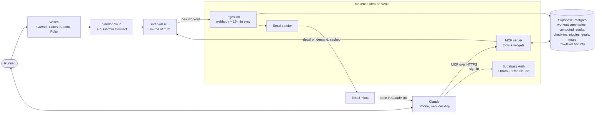
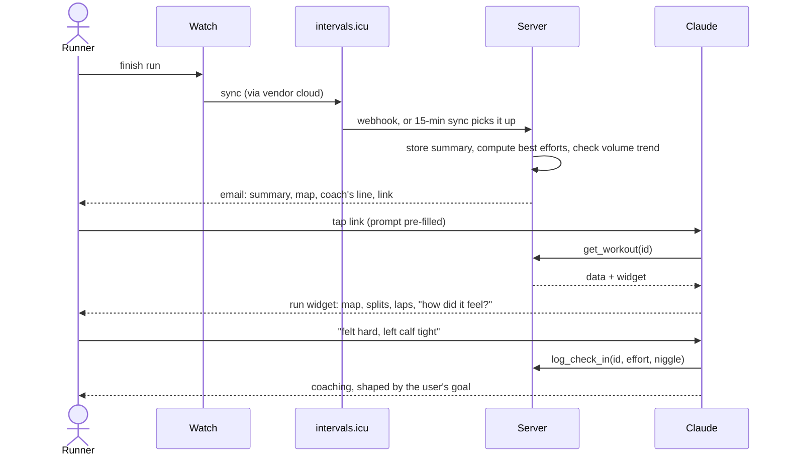

# Architecture

Two pictures: how the parts fit together, and what happens after a run. Both render on GitHub. Keep them current when a component or flow changes.

## The system



**Boundaries.** intervals.icu owns the raw data. The server owns summaries, computed results and what the user tells us, all keyed by user with row-level security. Claude owns the conversation, memory and voice. Secrets live only in Vercel and Supabase settings.

## After a run



## Code layout

```
packages/domain   model, maths, formatting; pure TypeScript, no I/O
apps/server       Next.js on Vercel: MCP endpoint and widgets, ingestion, email, onboarding pages, auth glue
```

Dependencies point one way: `apps/server` depends on `packages/domain`; nothing depends on `apps/server`. Routes and MCP tools stay thin; services and domain functions hold the logic.
