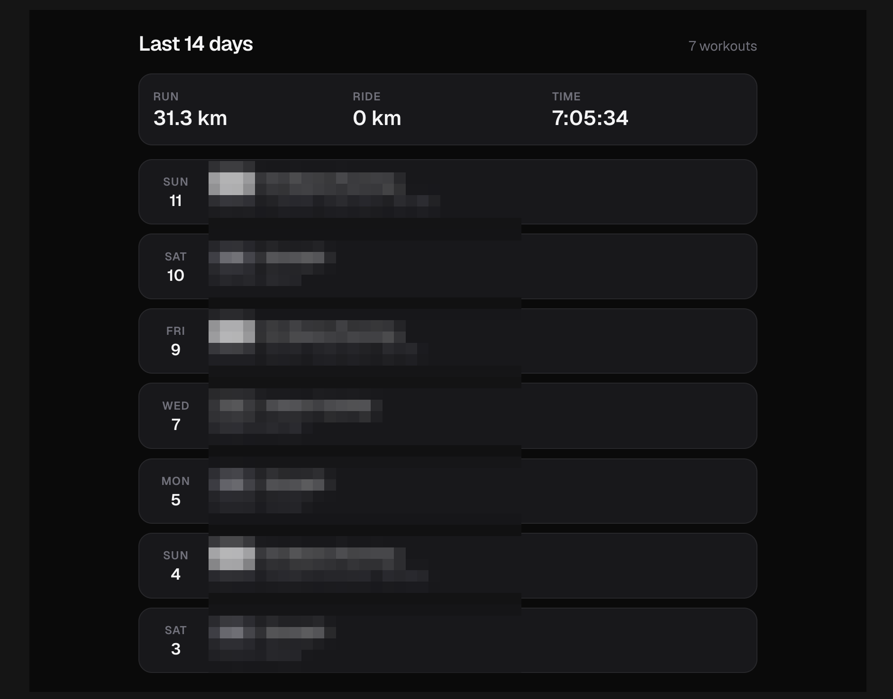
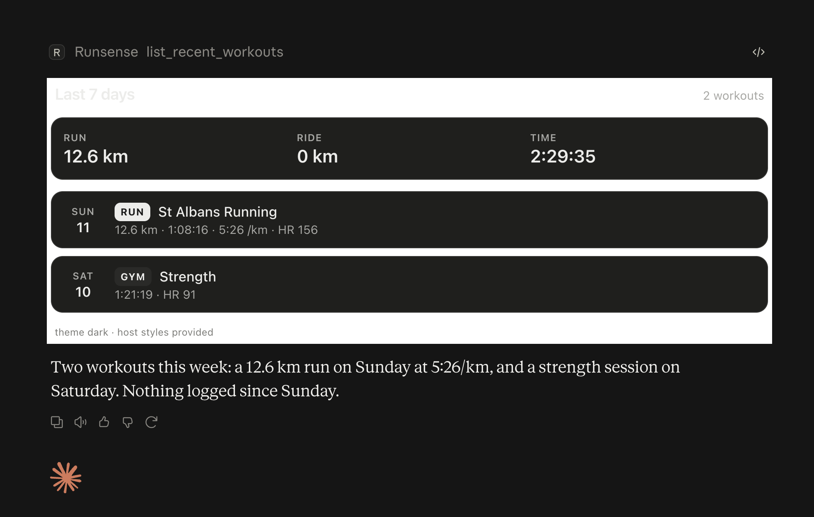
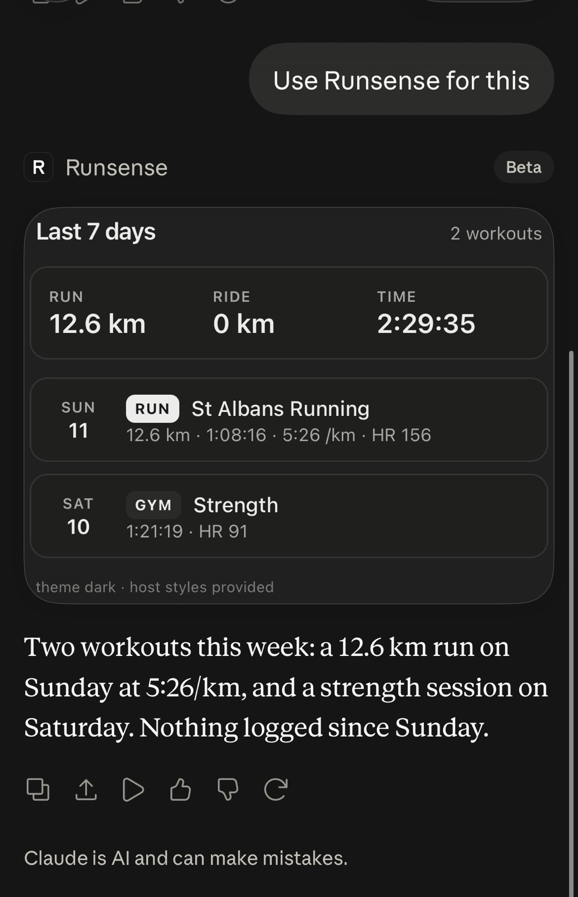
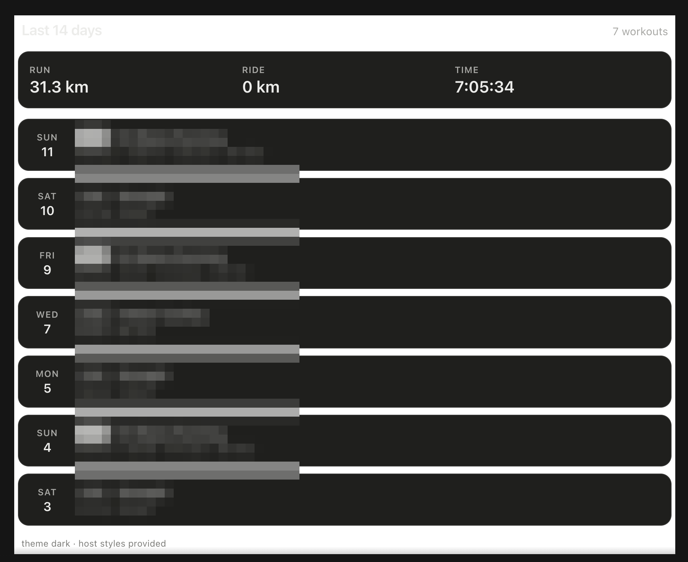
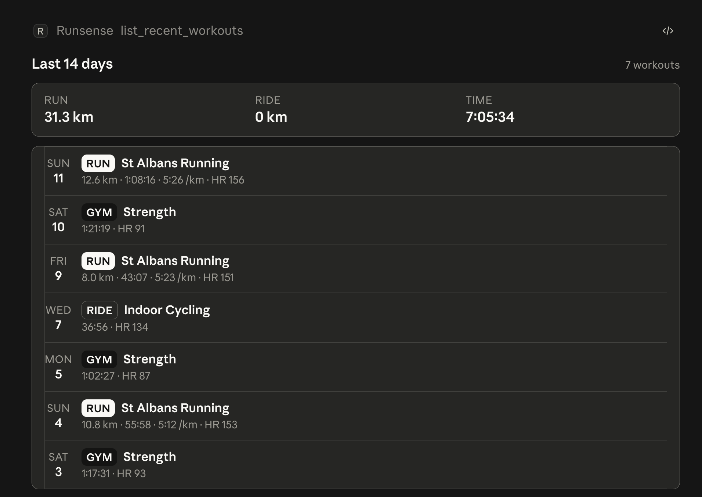
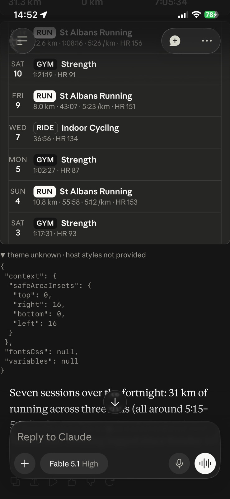
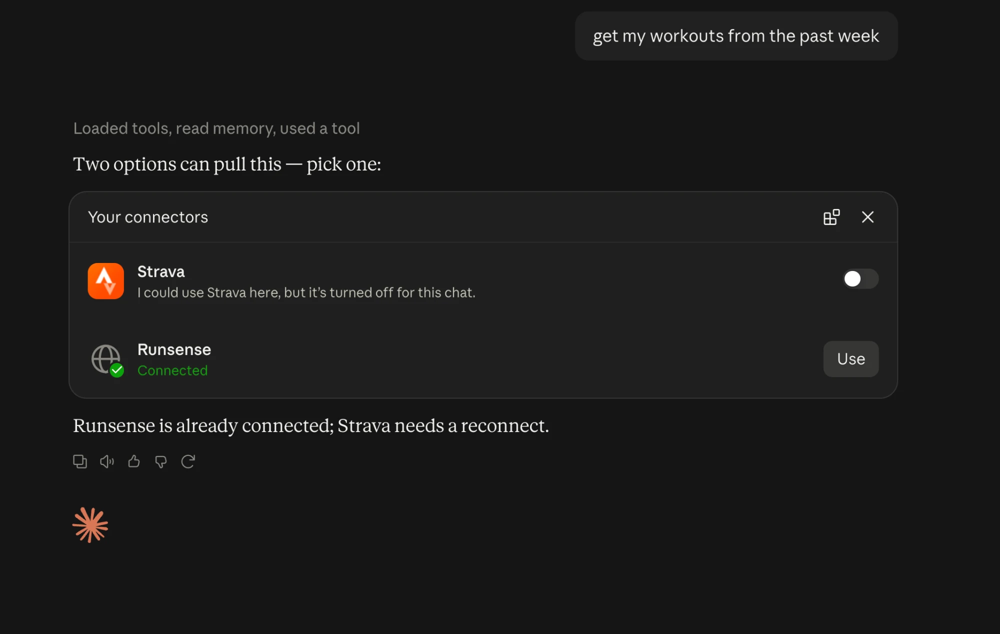
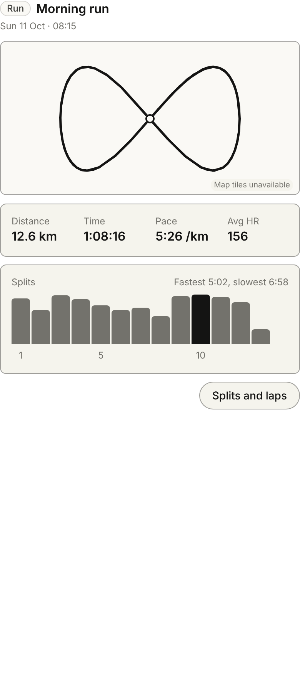
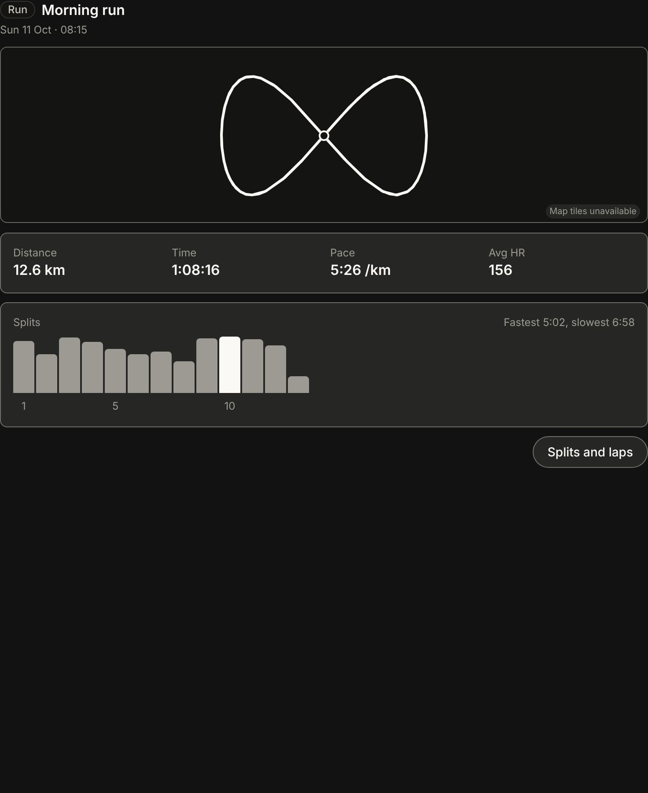

# Decision log

One line per decision, oldest first. Kept concise for the engineering write-up. This file is the master copy and is updated in the same commit as the change it records; see CLAUDE.md.

| Date | Decision | Why | Instead of |
| --- | --- | --- | --- |
| 25 Sep 2026 | Build a private Strava-style app for my own Garmin data, incrementally and test-first | Each slice is testable on its own; ground rules are DRY, KISS, YAGNI, SOLID, linting, OWASP, the test pyramid and TDD | A big-bang build |
| 25 Sep 2026 | Rule out the Strava API | Its June 2026 policy bans any AI use of the data, including a model's context window, and needs a paid subscription | Strava as the data source |
| 25 Sep 2026 | Rule out HealthKit as the main source | Garmin writes workouts to Apple Health without the GPS track, with only high and low heart rate and no laps | HealthKit only |
| 25 Sep 2026 | Park Garmin's own API | Push-only to a server you host, 30-day backfill, business-only, and frozen to new applicants since spring 2026 | Garmin direct from day one |
| 25 Sep 2026 | Use intervals.icu as the data source | Approved Garmin partner, free, direct watch connection, full streams and laps, API terms that allow AI use, one year of backfill plus FIT upload for older history | Strava, HealthKit, Garmin direct |
| 25 Sep 2026 | iOS only on Expo | HealthKit was iOS-only anyway and Expo kept Android open. Superseded on 16 Oct | iOS and Android |
| 26 Sep 2026 | A thin backend from day one | Webhooks need a public endpoint, secrets stay off the phone, the coach and stats run server-side, and OWASP ASVS applies properly | A local-first app with no server, my first draft |
| 26 Sep 2026 | Host on Vercel | Free tier, deploys on push, streams responses. Daily-only cron and time-limited functions shaped the sync design | Railway, Fly.io, Cloudflare Workers |
| 26 Sep 2026 | Next.js route handlers in TypeScript | Already familiar, Vercel-native, and one shared domain package across app and API. The analysis is arithmetic, not data science | Hono, Express, Python with FastAPI |
| 26 Sep 2026 | Supabase Postgres with Drizzle, tests on PGlite | Mainstream database, PostGIS for routes later, pg_cron for a 15-minute sync, a dashboard. In-memory Postgres keeps tests fast | Turso, Neon |
| 26 Sep 2026 | Mocks before code | A grayscale clickable prototype of six screens and three coach concepts settled chat-first versus classic before anything became code. HTML first, Figma after | Designing in Figma first, or building screens straight into the app |
| 16 Oct 2026 | Build inside Claude as an MCP App, no native app | Claude supplies chat, memory and voice; widgets render inline or full-screen on iPhone, web and desktop; same backend; a stronger portfolio piece. Trade-off: no push, no offline, the conversation is the navigation | An Expo native app, or a Claude-hosted page |
| 16 Oct 2026 | Notify by email with an "open in Claude" link | Connectors cannot push. The email carries the summary and a map; the link opens Claude on the run. Desktop link is documented, iPhone to be tested | Native push notifications |
| 16 Oct 2026 | Multi-user: anyone can install it | intervals.icu OAuth per user, Supabase Auth as the OAuth 2.1 server Claude signs in with, row-level security from the first migration. Single user until Phase 1 | Single user only |
| 16 Oct 2026 | Aim the portfolio piece at AI-lab and tech recruiters | Adds an eval harness in CI, a public repo from the first commit, a ChatGPT cross-host check, and a write-up on the decisions and how the AI tooling was directed | Chasing download counts |
| 16 Oct 2026 | Build an initial prototype, evaluate it, then iterate, using each build to drive the next product decision | Real use of a working build answers product questions better than speculation does. The brief stays a living document and is revised after each build rather than fixed up front; each phase ends with something installable for that reason | Writing a complete specification first and building to it |
| 16 Oct 2026 | Map intervals.icu activities to one canonical `Workout`: sport buckets (run, ride, swim, strength, walk, other), virtual rides count as rides, running cadence doubled to steps per minute, UTC offset derived from the local and UTC start times | The source has 184 fields and names sports by device type; the coach needs a stable, small shape. Garmin reports running cadence as one leg's strides. The source omits the timezone name but always has both start times | Passing the raw source shape through to tools and widgets |
| 16 Oct 2026 | Lock the MCP endpoint with a shared bearer token sent as a Claude connector request header | An unauthenticated endpoint would serve personal workout data to anyone with the URL; a header is the simplest lock for the single-user phase and fails closed if unset. Per-user OAuth replaces it in Phase 1 | Leaving the endpoint open until OAuth lands |
| 16 Oct 2026 | Widgets follow Anthropic's MCP Apps design guidelines: transparent body, `color-scheme` meta, borderless frame, every structural style from the host's variables, three type sizes and two weights, skeleton loading, no nested scrolling | The host sends its theme, tokens and Anthropic Sans at runtime, so matching Claude exactly is a matter of using them rather than approximating by eye. Rules kept in docs/widget-design-rules.md | Our own palette and components styled to look like Claude |
| 16 Oct 2026 | One stable widget address, never versioned per deploy, with old addresses kept as aliases | Claude caches a connector's tool list and widget HTML when it is added; a per-deploy address left mobile pointing at a resource the server no longer served ("failed to load connector"). Fresh HTML still arrives on reconnect because the content is fetched live | The starter's versioned address as a cache-buster |
| 16 Oct 2026 | Build phases in the cloud, bootstrap and spike locally | Nothing needs the Mac now. One cloud session per phase opens a pull request while I am away; secrets never enter the repo | Everything local |
| 16 Oct 2026 | Keep a light, rebuildable copy: workout summaries, computed results and user notes, with detail fetched on demand | Summaries make the log, charts, trends and volume checks instant and let notes link by workout id; streams are rarely needed twice and holding them makes privacy and deletion heavier; intervals.icu stays the source of truth and already computes fitness, fatigue and form | Storing ids only and fetching everything live (slow, rate-limited, no cross-workout maths), or a full copy as source of truth |
| 16 Oct 2026 | One package, not a monorepo, with domain code in `src/domain` kept free of I/O | A single Next.js app keeps Vercel zero-config and avoids workspace tooling; the domain folder is the seam for a package later if a second app ever appears | The `packages/domain` + `apps/server` monorepo in PLAN.md (superseded on 16 Oct) |
| 16 Oct 2026 | npm, and the MCP 2.x packages (mcp-handler 2, ext-apps 2, @modelcontextprotocol/server 2) rather than the starter's pinned 1.x versions | npm needs no install for a single package. The 1.x line no longer resolves: ext-apps 1.7 needs SDK 1.29+ while mcp-handler 1.1 pins SDK 1.26. The 2.x line matches the 2026-07-28 spec the plan targets | pnpm; forcing the 1.x install with legacy peer resolution |
| 16 Oct 2026 | Draw the map ourselves: a static grid of tile images placed by our own slippy-map maths, with the route as SVG on top | About 80 lines of pure, unit-tested geometry and no map library; no pan or zoom inside an inline card, which the design guidelines discourage anyway; if tiles are blocked the route still shows on a plain card, so the spike's tile question answers itself on screen | Leaflet or MapLibre in the widget; a server-rendered map image |
| 16 Oct 2026 | Tiles from CARTO's free basemaps, light and dark to match the theme | No key, no sign-up, a quiet monochrome style that sits well in Claude, and a published free tier. OpenStreetMap's own tile servers discourage app use. Revisit before the public launch: a paid key may be needed at scale. Keyless use superseded on 16 Oct | OpenStreetMap tiles; a keyed provider such as Stadia or Mapbox |
| 16 Oct 2026 | The GPS route travels inside the tool result as a simplified encoded polyline, at most 200 points | One auth boundary (the MCP endpoint), nothing for the widget to fetch, and about 1 KB of context for Claude. Douglas-Peucker with a tolerance that doubles until the track fits | A separate route endpoint the widget calls with a signed token; sending every GPS point |
| 16 Oct 2026 | Splits are computed from the streams; laps are read from the source's intervals | A split is a fixed distance, a lap is whatever the watch marked, and the two differ whenever auto-lap is off or the runner pressed the button. Computing splits ourselves keeps them consistent across sources | Treating intervals.icu's intervals as splits |
| 16 Oct 2026 | Inline detail widget shows map, four stats, a splits bar chart and one action; splits and laps tables live in full screen | Inline cards must fit without their own scrolling and keep to a few data points; a 21-row table does not. The single button also tests full-screen mode, one of the spike questions | Everything inline with a nested scroll; a tabbed inline card |
| 16 Oct 2026 | Build the detail tool against synthetic fixtures with a capture script for later, because the cloud session cannot reach intervals.icu. Superseded on 16 Oct | The environment's network policy blocks intervals.icu, so the mapper is defensive about field names and `scripts/capture-fixture.mjs` turns a real response into anonymised fixtures when run locally | Waiting for the secrets to be added to the cloud environment |
| 16 Oct 2026 | CI fails on high-severity advisories in production dependencies only; dev dependencies are audited but reported, not blocking | A `braces` advisory with no fixed release, reached only through the ESLint plugin, would otherwise block every build including main. Dev tooling never ships to Vercel | Blocking on everything (no fix exists); ignoring advisories by id |
| 16 Oct 2026 | Read the GPS track from the `latlng` stream's two parallel series, `data` for latitude and `data2` for longitude, and drop samples without a fix in the mapper | The real API returns parallel arrays, not pairs, and has no separate longitude stream; the synthetic fixture had guessed pairs, so the map never drew. Dropping the pre-fix nulls at the source keeps the domain and widget free of them | Reading the `.csv` streams variant, which does have lat and lng columns; passing nulls through to the route code |
| 16 Oct 2026 | Capture fixtures from the cloud session through the proxy's injected intervals.icu credential; the capture script sends an auth header only when a key is set | The environment now reaches intervals.icu with the secret added by the proxy, so fixtures are real and anonymised rather than guessed. Node's fetch needs `NODE_USE_ENV_PROXY=1` to use that proxy | Running the capture locally only |
| 16 Oct 2026 | Tapping a row in the history widget posts a user message into the chat ("Show me the Morning run on Sun 11 Oct in detail (workout i1001)") via `ui/message`; Claude then calls `get_workout` and the detail widget renders. Rows are plain when the host does not advertise the message capability | The conversation is the navigation, so the detail appears where every other answer does and Claude can comment on it; nothing to build inside the history card; the id in the text makes the tool call unambiguous | Calling `get_workout` from the widget with `callServerTool` and drawing the detail inside the history card (a drill-in, which the guidelines discourage inline) |
| 16 Oct 2026 | Keep CARTO tiles, with a free key inlined at build time as `NEXT_PUBLIC_CARTO_API_KEY`; no key, no tiles | CARTO has required a key on raster tiles since 25 Sep 2026 (the widget showed an "API KEY REQUIRED" watermark). The key is free without an account, 5 million tiles a month non-commercial, and is public by design since it travels in tile URLs, so it needs no secret handling. Desktop Claude honours `resourceDomains`, which settles the spike's tile question | Switching to OpenStreetMap's tiles (their policy discourages app use, no dark style); passing the key through the tool result |
| 16 Oct 2026 | Type scale taken from the MCP Apps UI kit, read through the Figma connector: Body 16, Body emphasized 16 semibold for card titles and stat values, Body small 14, Caption 12; two weights, regular and semibold; the kit's `"salt" 1` font feature on all text; buttons 36px with an 8px radius and no fill | The kit is Anthropic's own definition of what Claude's surfaces use. Our earlier scale (14 body, medium weight, pill buttons) was a guess that read smaller and lighter than the chat around it, and the kit's inline card examples never use the 20px Heading inside a card | Keeping the guessed scale; using the 20px Heading for widget titles |
| 16 Oct 2026 | Enable the MCP Apps plugin from `modelcontextprotocol/ext-apps` for every session via `.claude/settings.json`, and follow its skills | The plugin carries the SDK authors' own rules (text fallback, CSP placement, handler order, React hooks, host variables) and points at the reference examples; checking our widgets against it found only two gaps, below. Project settings make it load for anyone who opens the repo, not just one machine | Relying on memory of the docs; installing it per user |
| 16 Oct 2026 | Host bridge built on the SDK's `useApp`, `useHostStyleVariables` and `useHostFonts` hooks, with a teardown handler and `sendLog` for host-visible warnings | What the plugin recommends for React apps; one less bespoke lifecycle to maintain. The starter's singleton hook persisted tool data in sessionStorage across client navigations, which a one-page widget iframe never does; the only remaining sessionStorage read is the headless render fixture, applied when there is no host | Keeping the starter's hand-rolled singleton bridge |
| 16 Oct 2026 | Goals set the coaching | The user states what they want (lose weight, feel better, a race time) and advice is shaped by it; evidence-based and conservative; niggles logged and trended, never diagnosed | A fixed coaching style |

## Still open

- [x] Maps in the widget: desktop Claude renders tiles from a `resourceDomains` host (16 Oct). iPhone still to check.
- [ ] Full-screen mode: the detail widget's "Splits and laps" button requests it. Waiting on the same check.
- [ ] Phone deep link: whether an email link pre-fills a Claude chat on iPhone. The spike decides.
- [ ] Coach concept: leaning towards rich answers (concept 3) with the coach thread's proactive comments (concept 1). Waiting on Marc's review of the mocks.
- [ ] intervals.icu webhooks for OAuth apps: unverified. Fallback is the 15-minute scheduled sync.
- [ ] Which training-load model drives volume warnings.

## Rendering notes: getting a widget to look like Claude (16 Oct 2026)

What went wrong in the first day of widget work, what Anthropic's [design guidelines](https://claude.com/docs/connectors/building/mcp-apps/design-guidelines), [theme-blending guide](https://claude.com/docs/connectors/building/mcp-apps/transparent-theming) and [troubleshooting page](https://claude.com/docs/connectors/building/mcp-apps/troubleshooting) said about it, and what we changed. Kept for the write-up; the rules themselves live in [docs/widget-design-rules.md](docs/widget-design-rules.md).

| What we saw | Cause | Guidance and fix |
| --- | --- | --- |
| First render looked like a static image: own dark panel, nested cards, no affordances | We painted our own background and drew cards inside Claude's card; nothing was tappable | Treat the widget as part of the conversation. Use Claude's card recipe once, add real affordances later (row tap, range switcher) |
| Desktop: white frame around a dark widget | The iframe's colour scheme differed from the page, so the browser painted its opaque backdrop | `<meta name="color-scheme" content="light dark">` plus a genuinely unpainted `html`/`body`, and `prefersBorder: false` so Claude adds no frame of its own |
| Mobile: double borders and padding | Mobile wraps widgets in a bordered card by default and we drew more cards inside it | Borderless frame; a single card drawn to Claude's recipe; honour `safeAreaInsets` (16px each side on iPhone) |
| Typography didn't match | We never allowed the font origin, and the starter's iframe guard stripped the `style` attribute Claude writes its variables into | Allow `https://assets.claude.ai` in `resourceDomains`; stop stripping `style` and `data-theme` on `<html>`; use the host's `--font-*` tokens |
| Mobile: "failed to load connector"; desktop showed an old design | Claude snapshots the tool list and widget HTML when a connector is added. We versioned the widget address per deploy, so cached clients pointed at an address the server no longer served | One stable address, old addresses kept as aliases, HTML fetched fresh on every read. Reconnect the connector once to clear the snapshot |
| Mobile shows no theme or tokens | Claude for iOS sends only `safeAreaInsets` today; desktop sends theme, all tokens and the font files | Fallbacks are the exact documented token values, so both platforms render the same |
| Cards, pills and bars invisible wherever the host sent no tokens (iPhone, and local rendering) | Our fallbacks used `light-dark()`. The CSS compiler rewrites it into helper variables that it only switches on where it sees a `color-scheme` declaration in CSS, and we only had the meta tag, so every fallback became an invalid colour | Declare `color-scheme: light dark` on `:root`, and `light`/`dark` under the host's `data-theme` attribute. Found by rendering the widget headless with fixture data, now part of checking a widget |
| Claude kept offering Strava alongside Runsense | Two connectors answer the same question; a disabled connector still appears in the chooser | Remove Strava while testing; a Coach project instruction settles it later; keep our tool descriptions specific |

